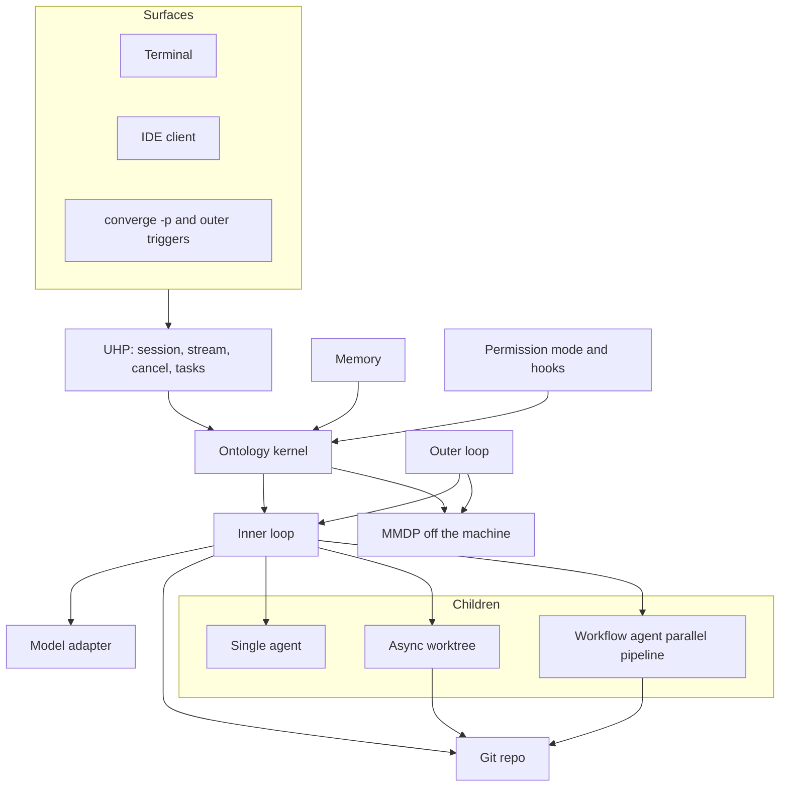
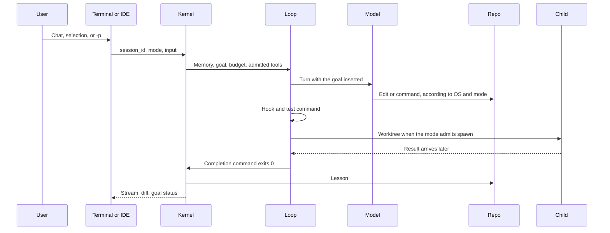

# Architecture

One session has surfaces, a kernel, loops, and a repo. MMDP appears when the session leaves the laptop.

## Context

## End-to-end flow

The outer loop uses the same flow when the trigger is a schedule or a git event. An outer round may be a new process with an empty context. Progress is read from git and the session store. The verifier is the test command or a child that only reads.

## Planes

| Plane | Role for the CLI and IDE |
|---|---|
| UHP | Session, stream to the terminal and clients, cancel, resume, `/tasks` |
| A2A | Delegation. A message carries the goal and the worktree path, not file contents |
| MCP | External tools. Schemas of servers that are not in use stay out of the initial context |
| MMDP | Data, compute, and the model catalog when the session leaves the laptop |
| Kernel | Schema, functions, actions |
| Security | Permission decisions, hooks, budget, lineage. Bytes do not pass through here |

Contract details are in [10-planes.md](10-planes.md).
